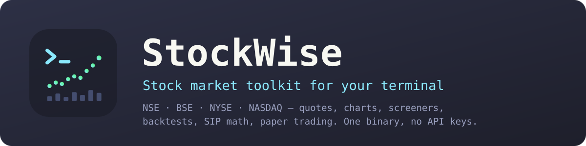
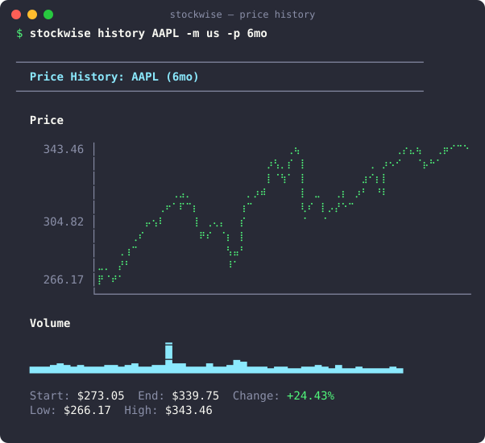
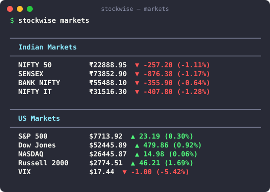
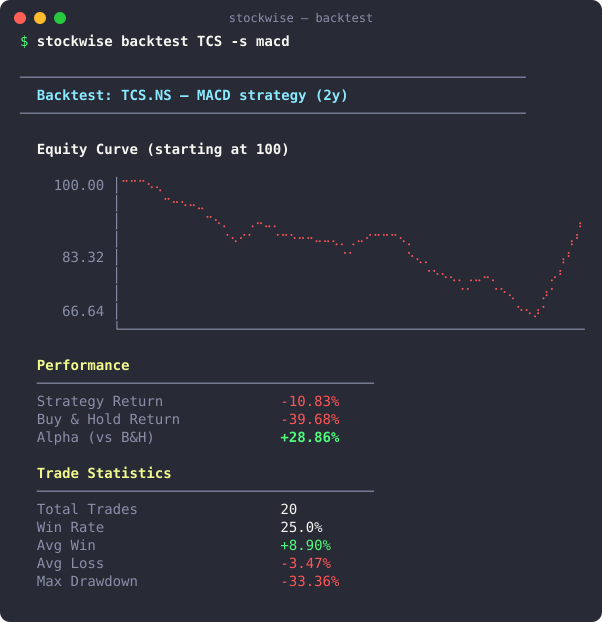
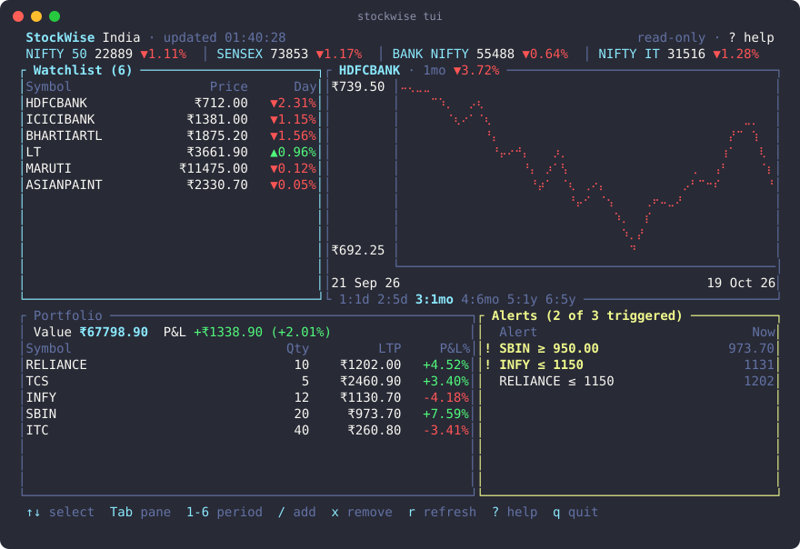

<p align="center">
  
</p>

<p align="center">
  <a href="https://github.com/iamsaquib8/stockwise/actions/workflows/ci.yml"></a>
  <a href="https://crates.io/crates/stockwise"></a>
  <a href="https://crates.io/crates/stockwise"></a>
  <a href="https://github.com/iamsaquib8/stockwise/releases/latest"></a>
  <a href="LICENSE"></a>
  <a href="#install"></a>
</p>

<p align="center">
  <a href="#install">Install</a> ·
  <a href="#tour">Tour</a> ·
  <a href="docs/commands.md">Commands</a> ·
  <a href="#configuration">Configuration</a> ·
  <a href="CONTRIBUTING.md">Contributing</a> ·
  <a href="ROADMAP.md">Roadmap</a>
</p>

**StockWise is a stock market toolkit for your terminal, built for Indian
(NSE/BSE) and US stocks.** Quotes, charts, screeners, backtests, SIP math, paper
trading, and portfolio tracking in one fast Rust binary. No API keys, no
account, no browser tabs.

<p align="center">
  
</p>

```bash
stockwise quote RELIANCE TCS            # Indian stocks are the default
stockwise quote AAPL NVDA -m us         # US stocks
stockwise deep HDFCBANK                 # everything about one stock
stockwise backtest INFY -s macd         # test a strategy on 2 years of data
stockwise sip NIFTYBEES 5000 -p 5y      # what a ₹5,000/month SIP became (XIRR)
```

> **Not financial advice.** StockWise is for education and information. See
> [DISCLAIMER.md](DISCLAIMER.md).

## Why StockWise

- **India-first, US too.** `TCS` means `TCS.NS`; rupee formatting in lakhs and
  crores; NIFTY/SENSEX sectors; Indian tax years and LTCG/STCG; imports from
  Zerodha Kite and INDmoney. Add `-m us` (or `STOCKWISE_MARKET=us`) for US stocks.
- **Zero setup.** Public market data, no API key or sign-up. One binary for
  macOS, Linux and Windows. `stockwise doctor` checks everything.
- **60 commands, one muscle memory.** Fundamentals, technicals, risk, screeners,
  sector rotation, backtests, SIP/what-if calculators, alerts, tax estimates.
- **Scriptable.** `--json` on 21 data commands and `--csv` on their tables, a
  config file for your defaults, real exit codes, shell completions, and a
  read-only JSON API with Prometheus metrics (`stockwise serve`).
- **Live dashboard.** `stockwise tui` keeps indices, watchlist, portfolio P&L,
  alerts and a chart on one refreshing screen.
- **Practice before money.** A paper-trading simulator and an intraday paper
  daemon with risk controls. Optional live orders via Angel One, behind a
  preview and a typed confirmation.
- **Private by design.** Your portfolio stays in local files. Optional AI runs
  on your own machine through [Ollama](https://ollama.com).

## Install

**macOS / Linux — prebuilt binary**

```bash
curl -fsSL https://raw.githubusercontent.com/iamsaquib8/stockwise/master/install.sh | sh
```

Installs to `~/.local/bin` (override with `STOCKWISE_INSTALL=/usr/local/bin`)
and verifies the release checksum. Every
[release](https://github.com/iamsaquib8/stockwise/releases/latest) also has
`.tar.gz` / `.zip` archives with the binary and man pages.

**Package managers**

```bash
brew install iamsaquib8/tap/stockwise            # Homebrew (after the tap is published)
yay -S stockwise-bin                             # Arch Linux, AUR (after the package is published)
nix profile install github:iamsaquib8/stockwise  # Nix flake (try it: nix run github:iamsaquib8/stockwise)
```

**Windows**

```powershell
scoop install https://github.com/iamsaquib8/stockwise/releases/latest/download/stockwise.json
winget install iamsaquib8.StockWise        # after the manifest is accepted into winget-pkgs
```

**Docker** (linux/amd64 and linux/arm64)

```bash
docker run --rm -it -v stockwise-data:/data ghcr.io/iamsaquib8/stockwise quote RELIANCE TCS
```

Portfolio, watchlist and alerts persist in the `stockwise-data` volume.

**With Rust**

```bash
cargo binstall stockwise    # prebuilt binary via cargo-binstall
cargo install stockwise     # or build from source (Rust 1.88+)
```

Then:

```bash
stockwise doctor                                          # check your setup
stockwise completions zsh > ~/.zfunc/_stockwise           # optional: tab completion
stockwise man --dir ~/.local/share/man/man1               # optional: man stockwise
```

Homebrew, AUR and Nix install the man pages and completions for you.

## Tour

<p align="center">
  
  
</p>

| | Commands |
|---|---|
| **Start here** | `quote`, `deep`, `markets`, `dashboard`, `search`, `doctor` |
| **Analysis** | `analyze`, `technical`, `history`, `chart`, `compare`, `risk`, `correlate`, `timeframes`, `returns`, `patterns`, `support`, `fibs`, `volume`, `gaps`, `stoploss`, `forecast` |
| **Market** | `movers`, `sectors`, `heatmap`, `sentiment`, `news`, `rotation`, `sectorcmp`, `peers`, `insider`, `ipo`, `earnings`, `surprise`, `matrix`, `picks`, `screen`, `dividends` |
| **Funds & F&O** | `mf` (search, nav, history, sip, screen, overlap), `options` (chain, pcr, maxpain, moves) |
| **Strategies & bots** | `backtest`, `sip`, `whatif`, `intraday`, `longterm`, `daemon`, `sim`, `report` |
| **Portfolio** | `portfolio`, `watch`, `alert`, `import`, `export`, `wealth`, `rebalance`, `harvest`, `tax`, `divcal`, `pcorr` |
| **Interfaces** | `tui`, `serve` |
| **Live trading** | `trade` (Angel One) |

`stockwise --help` shows the same groups; [docs/commands.md](docs/commands.md)
has every option.

### Track a portfolio

```bash
stockwise import kite ~/Downloads/holdings.csv   # or: portfolio add TCS 10 3500 --date 2023-04-12
stockwise portfolio                              # live P&L, XIRR + allocation
stockwise portfolio sell TCS 5 3900              # FIFO sale, realized P&L kept for tax
stockwise portfolio actions --apply              # splits, bonuses and dividends since you bought
stockwise tax in                                 # LTCG/STCG per lot, set-off, realized vs unrealized
stockwise --portfolio us portfolio add AAPL 3 190 -m us   # a second, named portfolio
stockwise dashboard                              # indices + portfolio + watchlist + alerts
```

Every purchase is a lot with its own date, so holding periods, FIFO sales and
XIRR are exact. Holdings in INR and USD are totalled in one currency
(`portfolio --base usd`) at the live `USDINR=X` rate.

### Mutual funds and options

```bash
stockwise mf search parag flexi direct     # AMFI scheme codes
stockwise mf sip 122639 5000 -p 5y         # monthly SIP with XIRR
stockwise mf screen flexi cap              # rank a category by 3Y CAGR
stockwise options chain NIFTY              # NSE chain with IV and greeks
stockwise options maxpain BANKNIFTY        # or: options pcr, options chain AAPL -m us
```

NAVs come from AMFI, option chains from NSE (India) or Yahoo (US). See
[docs/commands.md](docs/commands.md#funds--fo) for what has data and what doesn't.

### Watch it live

<p align="center">
  
</p>

```bash
stockwise tui                # ↑↓ select · 1-6 chart period · / add to watchlist · ? help · q quit
```

Read-only: the TUI never places orders. See [docs/tui.md](docs/tui.md).

### Script it

`--json` works on the data commands (`portfolio`, `watch`, `alert`, `technical`,
`risk`, `backtest`, `screen`, `movers`, `compare`, `tax`, ...) and `--csv` on
their tables. Only the data goes to stdout; errors go to stderr with a non-zero
exit code.

```bash
stockwise portfolio --json | jq '.totals.pnl_percent'
stockwise portfolio --csv > portfolio.csv                # straight into a spreadsheet
stockwise history AAPL -m us -p 6mo --csv > aapl.csv     # every OHLCV bar
stockwise alert check --json | jq -r '.[] | select(.status == "triggered") | .symbol'
stockwise technical TCS --json | jq '{rsi_14, bias}'
stockwise backtest INFY -s macd --json | jq '.total_return_percent'
stockwise quote ZZZZ || echo "lookup failed"             # non-zero exit on errors
stockwise serve                                          # the same JSON over HTTP + /metrics
curl -s localhost:8787/api/portfolio | jq '.totals'
```

Every JSON shape and CSV column is listed in
[docs/commands.md](docs/commands.md#scripting-with---json-and---csv).

`serve` has no trading endpoints and refuses non-loopback addresses unless you
pass `--allow-remote` with a `STOCKWISE_API_TOKEN`. See
[docs/server.md](docs/server.md).

### Paper trade, then decide

```bash
stockwise sim start 100000          # paper session with the bot's picks
stockwise sim status                # live P&L
stockwise daemon intraday 25000     # NSE-hours paper loop: 1% risk/trade, 3% daily stop
stockwise sim settle                # after the close: replay the day's 5-minute bars
stockwise sim history               # track record + confidence rating
```

The daemon never sends broker orders. It runs on the exchange clock (IST,
NSE holidays included), survives network blips, resumes after a restart, and
squares off on Ctrl+C. Read [docs/bot-design.md](docs/bot-design.md) for how
it decides.

### Alerts and notifications

```bash
stockwise alert add TCS above 4200
export STOCKWISE_TELEGRAM_TOKEN=... STOCKWISE_TELEGRAM_CHAT_ID=...
stockwise notify test               # Telegram, Slack, Discord, email or desktop
stockwise alert watch               # checks during market hours, notifies once per trigger
```

See [notifications](docs/bots.md#notifications) for every channel.

### Live orders (optional, Angel One)

```bash
stockwise trade setup                          # how to create owner-only credentials
stockwise trade buy RELIANCE 10 --dry-run      # resolve + preview, send nothing
stockwise trade buy RELIANCE 10                # preview, then type "yes" to send
```

Orders resolve the exact NSE instrument, show the estimated value, respect an
optional `max_order_value` cap, and refuse to run unattended without `--yes`.
See [docs/angel-one.md](docs/angel-one.md).

### Local AI (optional)

With [Ollama](https://ollama.com) running, `stockwise report TCS` writes an AI
stock report, and `--ai` adds commentary to `analyze`, `technical`, `compare`,
`screen`, `backtest` and `deep`. It's opt-in because local models take 30–60s.
Prefer a hosted model? Set `STOCKWISE_AI_PROVIDER` to `openai`, `anthropic` or
`gemini` with your key — still only for `report` and `--ai`, with a notice
whenever data is sent. See [docs/ai.md](docs/ai.md).

### Crypto, forex and Hindi

```bash
stockwise quote BTC ETH -m crypto                    # BTC-USD, ETH-USD — trades 24/7
stockwise quote BTC -m crypto --quote-currency inr   # BTC-INR
stockwise quote USDINR EURUSD -m fx                  # USDINR=X, EURUSD=X, 4 decimals
stockwise markets --crypto --fx                      # indices + top coins + major pairs
stockwise dashboard --lang hi                        # हिन्दी में (also STOCKWISE_LANG=hi)
```

## Configuration

Everything works with no config. To keep your own defaults, create a config
file:

```bash
stockwise config init     # writes a commented config.toml
stockwise config show     # effective settings and where each comes from
```

```toml
market = "us"
model = "llama3.1:8b"

[periods]                 # default -p per command
technical = "6mo"
backtest = "5y"
```

Each setting can also come from an environment variable or a flag.
Precedence: **flag > environment variable > config file > built-in default.**

| Config key | Env var | Flag | Purpose |
|------------|---------|------|---------|
| `market` | `STOCKWISE_MARKET` | `-m` | Default market: `in` (default), `us`, `crypto` or `fx` |
| `quote_currency` | `STOCKWISE_QUOTE_CURRENCY` | `--quote-currency` | Currency for bare crypto tickers with `-m crypto` (default `usd`; `inr` gives `BTC-INR`) |
| `lang` | `STOCKWISE_LANG` | `--lang` | Output language: `en` or `hi` (Hindi). Default: your locale (`LANG=hi_IN…` picks Hindi) |
| `home` | `STOCKWISE_HOME` | | Where portfolio, watchlist, alerts and history are stored |
| `portfolio` | `STOCKWISE_PORTFOLIO` | `--portfolio` | Named portfolio to use |
| `data_provider` | `STOCKWISE_DATA_PROVIDER` | | Opt-in data provider: `alphavantage`, `massive` (Polygon) or `twelvedata`, with its API key in the environment — see [docs/data-providers.md](docs/data-providers.md) |
| `ai` | `STOCKWISE_AI` | `--ai` / `--no-ai` | Add AI sections by default |
| `ai_provider` | `STOCKWISE_AI_PROVIDER` | | `ollama` (default, local), or opt-in cloud: `openai`, `anthropic`, `gemini` with `OPENAI_API_KEY` / `ANTHROPIC_API_KEY` / `GEMINI_API_KEY` in the environment — see [docs/ai.md](docs/ai.md) |
| `model` | `STOCKWISE_MODEL` | | AI model (Ollama default `qwen3:14b`) |
| `ollama_host` | `OLLAMA_HOST` | | Ollama server (default `http://localhost:11434`) |
| `redis_url` | `STOCKWISE_REDIS_URL` | | Optional shared cache (`redis://…`), or `off` |
| `[periods] <command>` | | `-p` | Default period for `technical`, `history`, `risk`, `backtest`, `sip`, ... |
| `[notify] telegram_token`, ... | `STOCKWISE_TELEGRAM_TOKEN`, `STOCKWISE_SLACK_WEBHOOK`, … | | Notification channels — see [docs/bots.md](docs/bots.md#notifications) |
| | `STOCKWISE_BIND` / `STOCKWISE_API_TOKEN` | `serve --bind` | `serve` address and bearer token |
| | `STOCKWISE_CONFIG` | | Use another config file |
| | `NO_COLOR` | | Disable colours (also automatic when piping) |

The file lives in your platform's config directory (`stockwise config path`
prints it); see [docs/commands.md](docs/commands.md#configuration-file) for
details. API keys and the server token are read from the environment only.

The same settings work as flags: `-m crypto`, `--quote-currency inr`,
`--lang hi`, `--ai`. Run `stockwise doctor` to see what is active.

## Docs

- [Commands reference](docs/commands.md)
- [Terminal dashboard](docs/tui.md) and [HTTP API & metrics](docs/server.md)
- [Trading bots](docs/bots.md) and [bot design](docs/bot-design.md)
- [Angel One setup](docs/angel-one.md)
- [AI: Ollama and cloud providers](docs/ai.md)
- [Data providers](docs/data-providers.md)
- [Architecture](docs/architecture.md)

## Roadmap & contributing

Next up: more brokers (Zerodha, Upstox) and Hindi for every command — see the
[ROADMAP](ROADMAP.md). Ideas and bug reports are
welcome in [Discussions](https://github.com/iamsaquib8/stockwise/discussions) and
[Issues](https://github.com/iamsaquib8/stockwise/issues); start with
[CONTRIBUTING.md](CONTRIBUTING.md).

If StockWise is useful to you, a ⭐ helps other people find it.

## License

[MIT](LICENSE) © iamsaquib8. Market data comes from Yahoo Finance and your
broker; StockWise is not affiliated with any exchange, broker, or data provider.
See [DISCLAIMER.md](DISCLAIMER.md).
