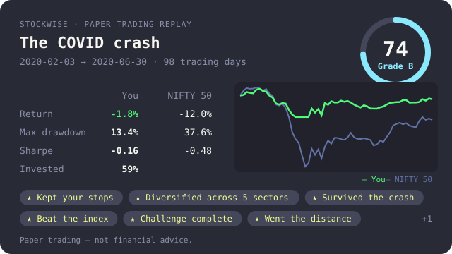

# Practice mode: replays, challenges and scores

Practice mode turns the paper-trading simulator into a way to learn. You trade
a past market one day at a time, without seeing what comes next, and you get a
score for **how** you traded: return for the risk you took, how deep your
drawdowns went, whether you kept to your own rules, and how widely you spread
your money. Raw return never scores on its own.

Everything here uses paper money. Nothing in practice mode can reach a broker,
and every scorecard and card says so: **paper trading — not financial advice.**

- [A five-minute tutorial](#a-five-minute-tutorial)
- [Replays](#replays)
- [Challenges](#challenges)
- [Scores, grades and badges](#scores-grades-and-badges)
- [Profile and result cards](#profile-and-result-cards)
- [Your own scenarios and challenges](#your-own-scenarios-and-challenges)
- [JSON output](#json-output)
- [Files and limits](#files-and-limits)

For the bot-driven daily simulator (`sim start`, `sim settle`) see
[bots.md](bots.md#paper-trading-simulator).

## A five-minute tutorial

```bash
stockwise sim replay list                       # the built-in scenarios
stockwise sim replay start covid-crash-2020     # 3 Feb 2020, ₹1,00,000 of paper money
stockwise sim challenge start crash-survivor    # optional: play for a goal
```

You see the account, the challenge and the market on the replay date: every
stock's close, its change on the day and over 20 trading days. That is all
you know — the same as an investor on that morning.

```bash
stockwise sim replay chart index                 # NIFTY 50 up to today's close
stockwise sim replay chart TCS --days 120
stockwise sim replay buy TCS 10 --stop 1900      # decide where you are wrong first
stockwise sim replay buy HINDUNILVR 8 --stop 2000 --target 2600
stockwise sim replay next                         # orders fill at tomorrow's open
stockwise sim replay status
stockwise sim replay next 5                       # five trading days at once
stockwise sim replay set TCS --stop 2000          # move a stop
stockwise sim replay sell TCS                     # the whole position, at the next open
stockwise sim replay end                          # scorecard, badges, what happened
stockwise sim card --svg card.svg                 # share the result
```



## Replays

`sim replay start` takes a built-in scenario, a scenario file, or your own
window:

| Scenario | Market | Window | Benchmark |
|----------|--------|--------|-----------|
| `covid-crash-2020` | India, 20 NIFTY 50 stocks | Feb – Jun 2020 | NIFTY 50 |
| `gfc-2008` | India, 19 large companies | Aug 2008 – Mar 2009 | NIFTY 50 |
| `adani-2023` | India, 6 Adani companies + 10 heavyweights | Jan – Apr 2023 | NIFTY 50 |
| `dotcom-2000` | US, 16 stocks | 2000 | Nasdaq Composite |
| `bull-run-2021` | India, 18 NIFTY 50 stocks | Jan – Oct 2021 | NIFTY 50 |
| `rate-hikes-2022` | US, 16 large companies | Jan – Oct 2022 | S&P 500 |

```bash
stockwise sim replay start --from 2022-01-03 --to 2022-06-30 --symbols TCS,INFY,HDFCBANK,ITC
stockwise -m us sim replay start --from 2008-09-02 --to 2009-03-31 --symbols JPM,BAC,XOM,KO --benchmark ^GSPC
stockwise sim replay start covid-crash-2020 --capital 500000 --costs none
```

A custom window uses the global market (`-m in`, the default, or `-m us`) and
benchmarks against NIFTY 50 or the S&P 500 unless you pass `--benchmark`. Its
stocks have no sector, so the diversification part of the score only counts
the number of stocks; write a [scenario file](#your-own-scenarios-and-challenges)
to name sectors.

**The future stays hidden.** At the start, StockWise downloads each stock's
daily history once (about a year before the window, for charts, through the
window's end) and saves it next to the replay. From then on the replay runs
offline. The price data lives in one place, and every view — tables, charts,
scorecards and `--json` — reads it only up to the replay date. A test plants
impossible prices after the replay date and checks that none of them, and none
of their dates, appear in any output.

**How orders fill.** The replay day is over when you see it: you know its
close. Orders you place fill at the **next trading day's open**:

- Sells fill before buys on the same morning, so you can rotate from one stock
  to another in one step. A buy that the cash no longer covers (a gap up) is
  cut to what you can afford.
- Every fill pays slippage and the same charges as the backtester
  ([costs](backtesting.md#costs)): India delivery (brokerage, STT, exchange
  and SEBI fees, GST, stamp duty, DP charge) for NSE stocks, the US model for
  US stocks. `--costs none|in-delivery|in-intraday|us` overrides the choice.
- After the fills, stop-losses and targets are checked against the day's low
  and high. A stop fills at its level, or at the open if the stock gapped
  through it; when a day touched both, the stop is assumed first.
- Long only: no short selling and no leverage. A stock that did not trade on a
  day (a halt, or a gap in the data) keeps its order waiting.

`sim replay next N` moves up to `N` trading days and prints what happened each
day. On the last day of the window, run `sim replay end`; you can also end
early — a run of fewer than five trading days is not scored. `end` shows the
scorecard and then the scenario's debrief: what actually happened.

## Challenges

A challenge is a set of rules and goals, played over a replay or over your
live paper sessions (the bot's `sim start` picks, settled by `sim settle`).

```bash
stockwise sim challenge list
stockwise sim challenge start steady-hands       # inside the running replay
stockwise sim challenge status
stockwise sim challenge end                      # give up, or score a finished live one
```

| Challenge | Length | Rules (checked as you trade) | Goals (checked at the end) |
|-----------|--------|------------------------------|----------------------------|
| `beat-the-index` | 30 days | — | return above the benchmark; ≥ 30% invested on average |
| `steady-hands` | 30 days | drawdown ≤ 10% (hard) | ≥ 50% invested on average |
| `position-limit` | 30 days | no position above 20% of capital (hard) | hold 5 stocks at once |
| `stop-loss` | 30 days | every buy has a stop-loss (hard) | 5 or more buys |
| `sip-discipline` | whole replay | ≥ 90% invested at every month end | end above a plain monthly SIP into the benchmark |
| `crash-survivor` | whole replay | — | worst drawdown under half the benchmark's; ≥ 30% invested |

**Hard rules** cannot be broken by accident: an order that would break one is
refused with the reason, and a hard rule broken by the market (a drawdown)
ends the challenge as failed. **Soft rules** are recorded and cost discipline
points. Position size is judged when you place the order, at the last close.

`sip-discipline` starts on the replay's first day, before any order: your
account begins with one month's contribution (10,000 in the replay's currency)
and the same again arrives on the first trading day of every month. It is
compared with a plain SIP that buys the benchmark with the same money on the
same days — can your timing beat discipline? Returns are time-weighted, so
the money you add never counts as profit.

Over **live paper sessions** a challenge counts settled sessions from the day
you start it (one session = one day); the rules are checked over the trades
the bot made. Start it outside a replay, then use `sim start` each morning and
`sim settle` after the close.

## Scores, grades and badges

A finished run gets a score from 0 to 100, from four parts:

| Part | Points | What earns them |
|------|-------:|-----------------|
| Risk-adjusted return | 40 | your Sharpe and Sortino ratios against the benchmark's: half the points for matching it, all of them two points above it |
| Drawdown control | 20 | a worst drawdown small next to the benchmark's (with a 10% floor in calm markets) |
| Discipline | 25 | buys with a stop-loss (60%) and positions of at most 20% (40%); −10% per soft rule broken; none after a hard break or with no buys |
| Diversification | 15 | sectors held at the same time (5 for full marks, 60%) and stocks used (8, 40%) |

The first two parts scale with how invested you were, reaching full weight at
30% invested on average. Sitting in cash through a crash avoids the loss, but
it is not a trading decision worth points. Grades: **A+** 90+, **A** 80+,
**B** 70+, **C** 60+, **D** 50+, **F** below. The score is a pure function of
the run, so the same trades always score the same.

Badges are earned once and kept in your profile:

| Badge | How |
|-------|-----|
| Kept your stops | three or more buys, every one with a stop-loss |
| Diversified across 5 sectors | hold stocks from five sectors at the same time |
| Survived the crash | the benchmark falls 20%+ and you lose at most half as much, 30%+ invested, 20+ days |
| Beat the index | a higher return than the benchmark with a smaller drawdown, 30%+ invested |
| Steady hands | 20+ days at least half invested with a drawdown under 10% |
| Risk-adjusted winner | a Sharpe ratio of 1+ over 20+ days, above the benchmark's |
| Challenge complete | pass any challenge |
| Never missed a SIP | pass the SIP challenge without missing a month |
| Went the distance | play a replay to its last day |
| Three in a row | three disciplined runs in a row |

**Streaks.** A *disciplined run* is a scored run where every buy had a
stop-loss and was at most 20% of the account, and no rule was broken. The
profile counts disciplined runs in a row and challenges passed in a row.

## Profile and result cards

```bash
stockwise sim profile                   # badges (earned and how to earn the rest), streaks, best scores, recent runs
stockwise sim card                      # your last run as a text card, ready to paste
stockwise sim card --svg card.svg       # ...or as a 640 × 360 image
stockwise sim card --svg card.svg --text
```

The card shows the scenario, dates, score and grade, your return, drawdown and
Sharpe ratio next to the benchmark's, your curve against the benchmark, badges,
challenges and the disclaimer. It is built from your local profile: nothing is
uploaded, and there is no leaderboard.

## Your own scenarios and challenges

A scenario is a TOML file in the same format as the built-ins in
[`src/practice/scenarios/`](../src/practice/scenarios):

```toml
name = "my-2018-midcaps"
title = "The 2018 mid-cap fall"
market = "in"                  # in or us
from = "2018-01-01"
to = "2018-12-31"
benchmark = "^NSEI"
benchmark_name = "NIFTY 50"
capital = 100000
description = "Shown before and during the replay: don't give the ending away."
debrief = "Shown after `sim replay end`."

[[universe]]
symbol = "RELIANCE.NS"
sector = "Energy"
```

```bash
stockwise sim replay start file:my-2018-midcaps.toml
```

Challenges use the `[[challenge]]` format of
[`src/practice/challenges.toml`](../src/practice/challenges.toml), with these
rule kinds: `max_drawdown {percent, hard}`, `max_position {percent, hard}`,
`stop_loss_required {hard}`, `invest_each_month {percent, hard}` (rules), and
`beat_benchmark {margin_percent}`, `beat_sip` (needs `monthly_contribution`),
`min_exposure {percent}`, `min_positions {count}`, `min_trades {count}`,
`drawdown_vs_benchmark {ratio}` (goals). `days = 0` runs until the replay ends.

```bash
stockwise sim challenge start file:my-challenges.toml   # the file's first challenge
```

## JSON output

`--json` works on `sim replay list|start|next|buy|sell|status|end`,
`sim challenge list|start|status|end` and `sim profile`. Field names are listed
in [commands.md](commands.md#scripting-with---json-and---csv). Every replay
view carries the same no-future guarantee as the tables.

## Files and limits

| File (data directory) | What |
|------|------|
| `sim_replay.json` | the running replay: account, orders, fills, daily marks, challenge |
| `sim_replay_tape.json` | its cached daily prices (deleted by `sim replay end`) |
| `sim_challenge.json` | a challenge running over live paper sessions |
| `sim_profile.json` | badges, streaks, best scores and your last 50 runs |

- One replay at a time, and one challenge at a time inside it (start another
  when it finishes). Replays use daily bars only: no intraday fills.
- Prices are Yahoo Finance daily bars, adjusted for splits but not dividends,
  so a replay ignores dividends. A stock missing from Yahoo for the window is
  left out with a note; it is not valued at zero.
- Live paper trades carry no sector, so live challenges can't earn the sector
  badge.
- Practice mode is not shown in `tui` or the web dashboard yet.
